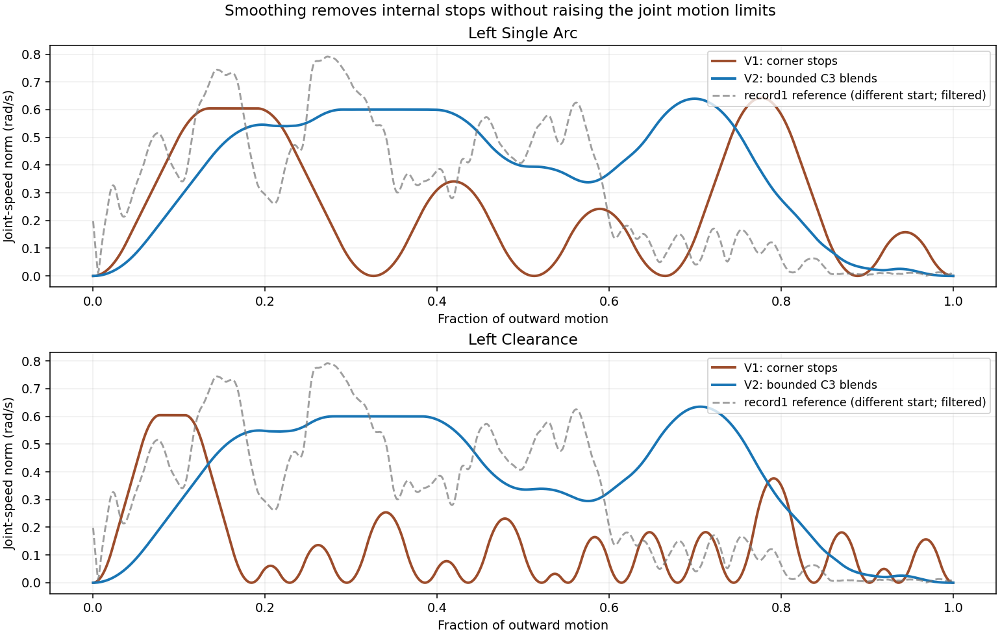

# Left-arm corner smoothing v2 — software experiment

## Outcome

Selected **overlapping C3 compact-kernel corner blending**, followed by the
existing adaptive time-density optimizer. This is a small, validated geometry
change, not a higher speed limit and not recording imitation. It is installed
only for corner-stop **left software-experiment** plans. All four path choices
remain; no additional selector or controls were added.

The original v1 code and policy are preserved byte-for-byte. Right geometry,
timing polynomials, density coefficients and durations are bit-identical for all
four default choices. Existing saved plans are not rewritten. Baseline hardware,
recordings, robot/tool models, calibration, raw candidate generation and ranking
were not modified by this experiment.

## Default left results

One-way motion durations (not computation time), before/after the new smoothing:

| Path choice | V1 seconds | V2 seconds | Internal stops, V1 → V2 | Speed CV, V1 → V2 | Largest sampled stick-tip shift |
|---|---:|---:|---:|---:|---:|
| Single arc | 5.174 | 3.391 | 4 → 0 | 0.744 → 0.179 | 3.32 mm |
| Clearance | 9.051 | 3.473 | 13 → 0 | 1.110 → 0.221 | 2.16 mm |
| Joint progress | 9.051 | 3.473 | 13 → 0 | 1.110 → 0.221 | 2.16 mm |
| Broad sweep | 8.022 | 3.398 | 10 → 0 | 1.122 → 0.225 | 1.22 mm |

All four also have **zero detected stick-tip internal stops and deep slowdowns**
in an independent FK/workspace-speed analysis. The selected blend halfwidths are
0.05 of joint arc for Single arc, 0.04 for Clearance/Joint progress, and 0.03 for
Broad sweep. Progress and Clearance select the same original candidate here;
there is no artificial difference added to their results.

The longest sampled wrist shift is 1.78 mm. The largest continuous joint-space
tube upper bound is 0.005629 rad (0.323 degrees L2), below the 1-degree limit.
These are changes relative to the original generated polyline—not errors
relative to the physical robot, camera, or recording.



The plot shows seven-joint speed **norm**, which can exceed the 0.6 rad/s
individual-joint limit without violating it. Each curve's time axis is normalized;
actual durations are in the table. Endpoint acceleration/deceleration is expected.

## Why it worked

V1 deliberately preserved exact piecewise-straight paths. A finite acceleration
cannot traverse a true sharp corner at nonzero speed; this forced rest-to-rest
motion even across tiny direction changes. Increasing the clock speed would
not remove those geometric discontinuities.

A corner is represented as a change in joint-space tangent. Integrating a
quintic smoothstep blends that tangent change over a compact neighborhood,
producing a C3 path. **Allowing adjacent blend intervals to overlap** is important:
a very short segment no longer forces an extremely small corner radius and
another near-stop. Endpoints remain exact and at rest. The unchanged adaptive
engine then optimizes time along the newly validated curve.

## Methods tried and retained

* **Global clamped quintic interpolation**, with several small simplification
  tolerances: rejected for excessive bounded deviation or detected collisions.
  A globally smooth fit is not automatically a safe nearby path.
* **Disjoint local C2 fillets**: removed literal stops but retained a major
  Clearance slowdown (coarse benchmark 8.756 s, speed CV 0.790).
* **Disjoint local C3 fillets**, several radii: useful for Single arc, but short
  segments kept Clearance slow/segmented (9.300 s and CV 0.781 at fraction 0.49).
* **Approximate vertex simplification**: rejected. Even a 0.00025-rad tolerance
  could remove a critical near-obstacle bend. Selected v2 removes only
  machine-precision collinear redundancy (1e-12 rad), not actual corners.
* **Overlapping C3 kernel blends**: smallest widths still caused slowdowns;
  moderate widths were smooth and fast. Overly wide blends hit the modeled
  scene and were rejected. Collision-valid widths were refined to 96 timing
  controls; the final durations/quality are above.

A common 8/16/32-control comparative run is saved in `studies/refined/report.json`.
At halfwidth 0.04, that coarse run gave Single arc 3.939 s / CV 0.221 and Clearance
3.960 s / CV 0.219, both with no deep slowdowns. Final tuning used
8/16/32/64/96 controls, `ftol=1e-10`, 400 iterations maximum per stage. This is
adequate for the requested smoothness; it is not a claim of global optimality.
The wider feasible Single arc blend (0.05) was selected for the final version.

All proposal implementations remain in `drum_planner/timing/rounding.py`; the
study driver is `rounding_study.py`. Initial, refined, width-screen and finalist
reports/laws are retained under `studies/`. The initial study includes an early
local-polynomial numerical-conditioning rejection; construction was subsequently
made analytic/stable, and refined comparisons use that corrected implementation.
Rejected blends are not executable outputs and are not test failures.

## Record1 comparison, not a generation input

`left_recordings/record1.json` lasts **6.075 s**, with zero
internal stops, 2 diagnostic deep slowdowns and joint-speed CV
**0.415** after a 0.2 s cubic Savitzky–Golay encoder filter.
The generated smooth paths have lower variation on this diagnostic, but that
**does not prove a human preference**. Record1 has a different starting pose and
longer joint travel; raw duration is not an equal-distance race. Filter sensitivity
(0.1/0.2/0.3 s) is retained in the study reports.

Record samples are read only by post-generation analysis scripts. No interior
recorded pose, velocity, timing or learned offset is fed into production smoothing.
The goal remains the existing final-pose input. The recording is a behavioral
reference, **not a safety certificate** or a reason to increase hard limits.

## Definitions and retained checks

Speed CV is standard deviation / mean of joint-speed norm over the interior
5–95% of joint arc. Cruise is that interior's 90th percentile speed. A stop is
a local valley below 5% of cruise; a deep slowdown is below 25%, with >=15%
prominence. Stop counting excludes only the first/last 0.5% of arc. These
scale-independent measures cannot be improved just by uniformly slowing motion.
The same diagnostic is applied to FK tip/wrist speed in the workspace audit.

The v2 policy rejects blends outside a **continuous 1-degree L2 joint tube**,
sampled wrist/tip shifts above 10 mm, joint limits, existing full-body/tool/stick
collisions, or the existing zone. The final actual timed polynomial is checked
again at 2 ms plus events with the dense 0.003-rad-L1 edge checker. Collision
margins and zone semantics are unchanged. Cartesian deviation and collision
checks are dense numerical tests, not a formal continuous collision proof.

Velocity/acceleration/jerk stay at **0.6 rad/s, 1.2 rad/s², 6 rad/s³** per joint.
The largest final left peaks across the four defaults are 0.59516 rad/s,
1.18079 rad/s² and 5.98204 rad/s³. Exact extrema and independent sampled checks
both pass. Start/goal, two-second goal hold, and exact reverse return are retained.

If a future path cannot be rounded satisfactorily within these bounds, v2
explicitly labels a v1 fallback. It never loosens collision checks or silently
claims a stop-filled fallback is smooth. Existing continuous left paths keep v1.

One known SciPy SLSQP diagnostic about bounding **temporary time-density trial
variables** is reported as an informational count, not as a robot-joint clipping
fault. Other warnings/errors are retained, and actual joint/motion checks still
fail normally. No joint target is clipped.

## Right-arm preservation

| Path choice | V1 and current outward seconds | Geometry and timing |
|---|---:|---|
| Single arc | 4.127995 | Bit-identical |
| Clearance | 4.229552 | Bit-identical |
| Joint progress | 8.073394 | Bit-identical |
| Broad sweep | 8.073394 | Bit-identical |

`preserved_sources.json` verifies 14 protected v1/generator/model/recording source
files. `integration_audit.json` verifies fresh exported right curves and clocks
against frozen v1 inputs, and independently revalidates all eight final laws.
`selected/` contains those laws, rounded/original curve sources and checks.

## Verification and resource use

* Full `./plan_drums.sh experiment --left/--right --headless --method all`
  runs successfully planned all four modes on each side.
* Both native Qt/VTK UI tests passed all four complete playback cycles,
  play/pause, seek, goal/start, display speed, loop, layers/colors, navigation,
  screenshots, settings accept/cancel, cancellation/requeue, budget invalidation,
  cache reranking and recovery after an intentionally injected capture failure.
  Recapture success was an explicit saved-file fixture, **not camera access**.
  Logs contain that deliberate failure traceback; no unexpected UI/worker failure
  occurred. Both windows were closed after testing.
* Default left exports have no joint-speed or tip-speed internal stops/deep
  slowdowns; opposite-arm transforms remain fixed through each full animation.
* Native preview screenshots were inspected; render detail is unchanged.
  Median VTK frame time was about 1.8 ms in both UI runs (not an end-to-end FPS claim).
* Planning remained serial, with the existing 3 GiB worker / 128 MiB swap caps,
  96-task cap and OS-level CAN denial. Across the recorded integration jobs,
  largest sampled worker memory was **371.9 MiB**. GUI memory is separate.
* **844 passed in 248.57s (0:04:08)** in the broad offline regression suite; see `regression.log`.
  This includes bounds/continuity, cache reuse/corruption, explicit fallback,
  analytic preview/return, no-device guards, repository artifacts and existing
  planner/controller/UI regression tests (hardware interfaces mocked).

Everything here is **software-only**, on the saved scene and saved poses. No
camera, CAN state queries, motor enable, movement or relaxation was performed.
Real motor tracking, current loading, calibration error and a changed drum kit
are not established by these tests.

## Run / reproduce

```bash
./plan_drums.sh experiment --left
./plan_drums.sh experiment --right
# Start a NEW session; historical plan.json files retain their old timing.
```

Detailed math and the study command are in `drum_planner/timing/README.md`.
`run_tests.sh` reproduces the software regression suite. `verify_ui.py SESSION
REPORT_DIR` exercises a prepared session using saved data. `analyze_results.py
LEFT_RESULTS_JSON RIGHT_RESULTS_JSON` compares production outputs and rechecks
the exported coefficients. All original v1 methods and its benchmark remain
available in `diagnostics/timing_experiment_20261021/` and `timing/benchmark.py`.

Background (primary documentation): [SciPy piecewise polynomial representations](https://docs.scipy.org/doc/scipy/tutorial/interpolate/splines_and_polynomials.html),
[SciPy BPoly derivative construction](https://docs.scipy.org/doc/scipy/reference/generated/scipy.interpolate.BPoly.html),
and [MoveIt time-parameterization documentation](https://moveit.picknik.ai/humble/doc/examples/time_parameterization/time_parameterization_tutorial.html)
for the need to recheck collision after path-changing smoothing. Our method is
custom C3 blending plus adaptive timing, not MoveIt TOTG or Ruckig.
