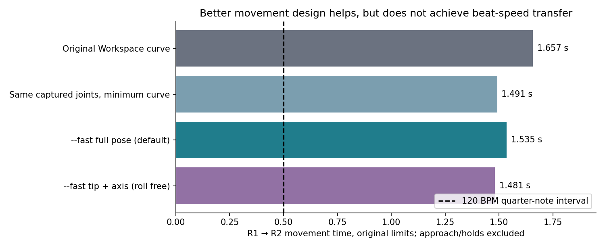
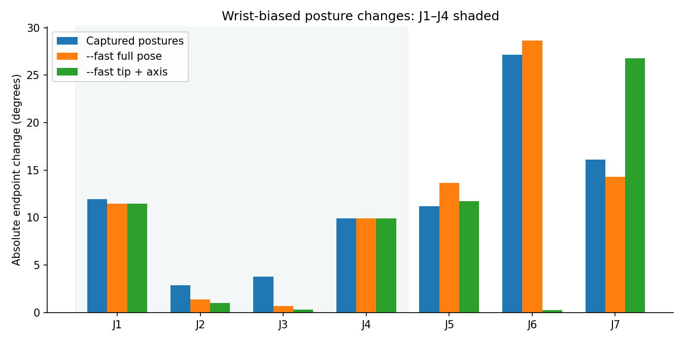

# --fast wrist-biased posture/path study

## Conclusion

**Better movement design is useful, but is not enough to reproduce record4 at beat
speed with the existing limits and these contact tasks.** A separate `--fast` mode
was implemented for both arms. It does not replace or edit the experiment program.
All tests in this task used saved inputs; no cameras, encoders or motors were accessed.

Default full-pose R1→R2 improves **1.656984 → 1.535314 s**
(**7.3% shorter**) while reducing
J1–J4 travel **28.573° → 23.439°**
(**18.0% less**).
Roll-free tip-axis mode takes **1.481426 s**, with
**20.5% less** proximal travel.
It requires as much as **68.6° of tool roll change**,
so it is explicitly optional, not the default, for only ~54 ms more gain.

Keeping proximal limits unchanged but hypothetically raising only distal limits
gets the new path to **1.042 s**, versus **1.355 s** for the old curve at those same
hypothetical limits. Thus design and joint-specific limits complement each other.
It still does not reach 0.5 s, much less the 0.25/0.1667 s eighth-note/triplet
intervals at 120 BPM. No higher limits were installed or physically tested.

## Implementation and use

```bash
./plan_drums.sh --fast --right
./plan_drums.sh --fast --left
```

Choose targets and Calculate fresh. The mode is **non-executable software preview**.
Normal user launch acquires a fresh query-only snapshot using the existing acquisition
code. That live-acquisition path was not exercised again in this task. All tests used
`--offline --state ... --scene ...`. See [FAST_PLANNER.md](../../FAST_PLANNER.md).

New code is isolated in `drum_planner/fast_mode/`; `drum_planner/cli.py` only adds
routing/help. Existing `experiment/`, timing, hardware programs, calibration, models,
recordings and destinations remain byte-identical to the pre-task snapshot.

The new generator optimizes task-equivalent joint postures, then tests a continuous
minimum-joint-motion curve. Existing Workspace curves are clearance alternatives.
A bounded native joint-corridor search plus independently checked quintic/C3 curves
handles obstacles when those fail. Original full-arm/stick checks, observed-obstacle
policy, calibrated bounds, passive-arm geometry, zones and margins are retained.

Full-pose preserves modeled tip position and full stick orientation. Tip-axis preserves
tip and stick direction, allowing roll. Neither permits an arbitrary contact-location
or stick-direction change. Endpoint errors are numerical IK errors, not claims of
physical micrometre accuracy. No recording interior is used as a route template.

Combined proximal endpoint travel cannot exceed the captured-pose reference. The
selected route minimizes actual proximal path travel among checked routes within 5%
of the fastest checked transfer. Other routes remain fallbacks if approach/return is
blocked. This is a stated speed-versus-body-motion compromise, not global optimality.

The optimized first playing posture is **not substituted for measured rest**: a checked
approach reaches it, and an independently checked return comes back from the last
target. Those times and all two-second preview holds are excluded from transfer times.
With only one target, the reported movement is **saved start→target**, not a drum-to-drum
transfer. No continuous-strike/impact or physical tracking controller was added.

## Inputs and controls

- Current captured R1/R2 and L1 were snapshotted in `inputs/`; source files unchanged.
- The fixed scene and both-arm snapshot came from the previous read-only acquisition
  at 2026-10-24T22:40:06 UTC. They were reused explicitly as **offline research inputs**,
  never current readiness evidence. Same scene/calibration/model/zone/margins for comparisons.
- Source state/scene/calibration identities: `inputs/provenance.json`. Scene is
  `diagnostics/r1_r2_wrist_speed_20261024/session/acquisition/camera/scene.json`.
- Original limits: **V=0.6 rad/s, A=1.2 rad/s², jerk=6 rad/s³** on all joints.
- Both old and new paths use the same existing sparse timing mathematics, 96 controls,
  600 iterations/8 s per stage, fresh CPU seed, no result cache. Those process-local
  research budgets do not alter the normal experiment's shorter settings. Original
  experiment results stopped at short budgets are not used as optimum references.
- FK/Jacobians use the exact generated calibrated URDF, verified against native FK
  for both arms and an independent URDF tree in unit tests.

## Main runs: actual --fast CLI

| Case | Movement | J1–J4 path travel | Cold calculation, comparison included |
|---|---:|---:|---:|
| right_full | 1.535314 s | 23.439° | 18.705 s |
| right_full_reverse | 1.535314 s | 23.439° | 20.007 s |
| right_axis | 1.481426 s | 22.716° | 19.658 s |
| right_axis_reverse | 1.483282 s | 23.291° | 25.020 s |
| left_full | 2.576657 s | 40.866° | 34.136 s |
| left_axis | 2.536478 s | 39.583° | 31.829 s |
| right_plus1 | 1.535673 s | 24.410° | 20.305 s |
| right_minus1 | 1.534872 s | 22.467° | 21.258 s |
| left_plus1 | 2.615720 s | 36.672° | 29.076 s |


All **9/9** final cold-process scenarios passed. Variations are synthetic ±1° at right
R2 J1 and +1° at left L1 J6, not new captured destinations. They test modest nearby
cases, not universal generalization. Right reverse tests use independently optimized
postures and checked approach/return, not a reversed cached trajectory.




### Separate route design from posture changes

On R1→R2, retaining the captured joint endpoints but using the new minimum-joint-motion
curve takes **1.491490 s**. The fastest tested full-pose alternate
postures take **1.471009 s** but do not reduce combined proximal
travel. The default wrist-biased selection instead takes **1.535314 s**
for an 18% proximal-travel reduction. That is about 4.4% slower than the fastest checked
new candidate, within the explicitly chosen 5% allowance.

Consequently, most of the raw speed improvement here comes from more direct joint
coordination; aggressively pushing movement toward the wrist trades some of that gain
for less proximal travel. It is not a free, large speed multiplier. Selected full-pose
endpoints still require about **11.46° at J1 and 9.94° at J4**. Some selected IK postures
lie at a calibrated joint bound; the study does not establish physical tracking margin.

### Left arm

There is only L1, so left results are saved-start→snare approaches, not L1→L2 beat
transfers. The direct curve and all existing Workspace proposals hit the captured
obstacle scene (native collision reports identified `left_drumstick` against depth).
This was not fixed by weakening bounds, deleting points or ignoring the stick.

A new bounded corridor alternative produced a valid continuous route. With captured
posture that route takes **2.700234 s**, with
**58.386°** proximal path travel.
The selected full-pose alternative takes **2.576657 s** with
**40.866°** proximal travel.
No speed ratio against the original Workspace planner is claimed: it found no route
in this scene. Some rejected/nonselected C3 candidates retained the explicitly logged
checked-seed timing fallback; selected final routes used sparse timing.

## Matched hypothetical limit follow-up

The exact old/new frozen curves were recalculated independently under matched per-joint
limits, with continuous extrema and native collision/zone checks: **12/12 cases passed**.
This follow-up is diagnostic only and is not wired into `--fast`.

| Hypothetical profile | Original Workspace | New full pose | New tip + axis |
|---|---:|---:|---:|
| original | 1.656984 s | 1.535314 s | 1.481426 s |
| distal_faster_body_unchanged | 1.355157 s | 1.042018 s | 1.041659 s |
| proximal_va_fixed_jerk4_distal4 | 0.937164 s | 0.869487 s | 0.869117 s |
| proximal_v_fixed_acc4_jerk8 | 0.677580 s | 0.559157 s | 0.558853 s |


Profiles (V / A / jerk, in rad/s, rad/s², rad/s³):

| Profile | J1–J4 | J5 | J6–J7 |
|---|---|---|---|
| original | 0.6 / 1.2 / 6 | same | same |
| distal_faster_body_unchanged | 0.6 / 1.2 / 6 | 1.2 / 4.8 / 48 | 2.4 / 19.2 / 384 |
| proximal_va_fixed_jerk4_distal4 | 0.6 / 1.2 / 24 | 2.4 / 19.2 / 384 | same as J5 |
| proximal_v_fixed_acc4_jerk8 | 0.6 / 4.8 / 48 | 1.8 / 10.8 / 162 | 2.4 / 19.2 / 384 |

For the selected new full-pose endpoints, the scalar rest-to-rest lower bound with
original proximal limits and faster distal limits is **1.040717 s**. The calculated
**1.042018 s** is already within ~0.13% of that bound. Under original limits on every
joint, its lower bound is **1.533420 s**, versus the calculated **1.535314 s**.
Therefore further timing/path tweaks with those **selected joint endpoints** cannot
provide a large improvement. This is not a global proof over every possible IK branch.

## What this says about record4

The tested better designs help, especially when combined with wrist-biased limits,
but do not deliver the desired sub-second beat transfers with all original limits.
The next useful physical investigation is measured joint-specific capability/jerk
validation, with separate explicit motion permission. Substantially faster transfers
will need higher validated dynamic limits and/or a continuous strike/rebound schedule
with different boundary conditions, possibly different contact orientations if those
are acceptable. Merely changing the GPU or repeatedly refining this clock will not
remove the remaining displacement/boundary-condition limits.

`record4` records **disabled-motor encoder feedback**. It is the desired motion
benchmark, not evidence that the powered motors can reproduce its speed under load.
No torque, thermal, structural-vibration, impact or controller-tracking performance was
validated here. No higher-limit trajectory is ready for physical execution.

## Calculation time

Fresh complete CLI invocations with saved inputs and **comparison disabled** took:

- Right R1/R2, including posture search, all candidate timing, approach and independent
  return checks: **12.391 s**.
- Left saved start→L1, including collision-avoidance searches: **30.629 s**.

These include process startup and initialization, but **not new camera/encoder
acquisition**. No stored trajectory or timing result was reused. Comparisons add extra
work (see main table). The mode has not met the earlier sub-10-second aspiration on
these complete runs; left obstacle search is particularly costly. It remains a separate
research mode rather than silently replacing the faster existing experiment.

## Verification

- **52 focused/regression tests passed** (`regression_tests.log`), including both-arm
  FK, analytic Jacobians, endpoint preservation, proximal-travel constraint, calibrated
  bounds, budget restoration, routing and pre-acquisition input rejection. The SciPy
  warnings concern bounded internal optimizer trial steps, not clipped encoder data.
- Native Qt/VTK on both sides: no startup calculation, real Calculate/Play/Pause/scrub/
  speed controls, fixed mesh, cancellation on selection change, invalid-selection retry,
  and close-time worker cleanup. `ui_results.json`; screenshots in `ui_right/` and `ui_left/`.
- Continuous position/velocity/acceleration/jerk checks, endpoint task checks and native
  full-arm/stick collision/zone checks for accepted results. All paths are preview-only.
- Completed planning groups retained the 3 GiB cap and excluded AF_CAN. No hardware
  access in this task. Source preservation and input identities: `audit.json`.

## Reproduction and retained evidence

`reproduce.py --output NEW_DIRECTORY` reruns the nine CLI cases serially against the
frozen inputs, not current destination files. `inputs/timing_sources.json` plus its
frozen URDF/SRDF preserve the three exact curves for the limit follow-up. `summary.json`,
`results.csv`, `verified/results.json` and `limit_followup/results.json` retain results;
raw worker runs remain local, not bulk Git artifacts. The one frozen scene required
for reproduction is explicitly retained, not used by normal fresh `--fast` launches.
