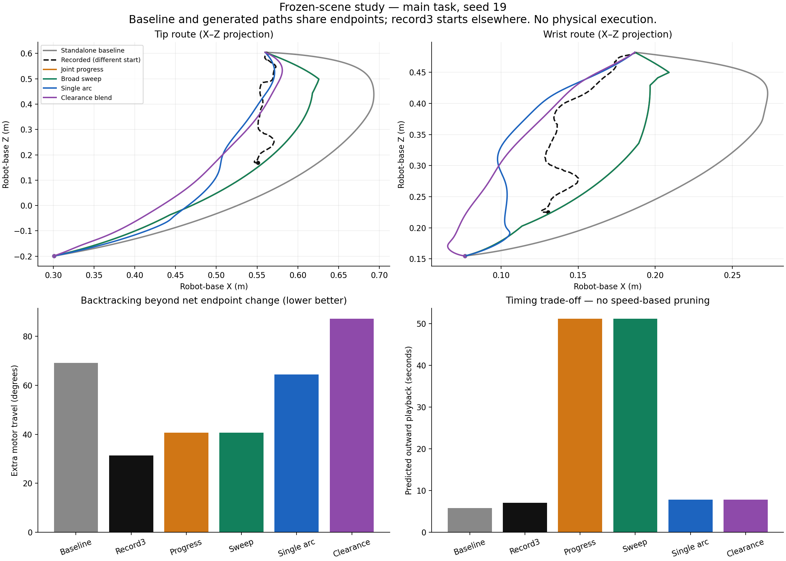
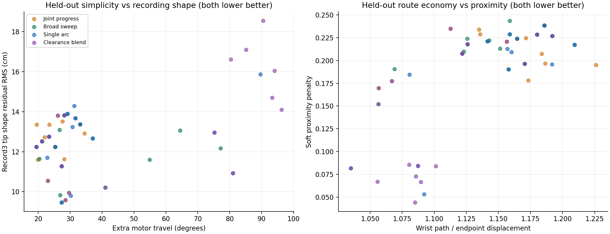
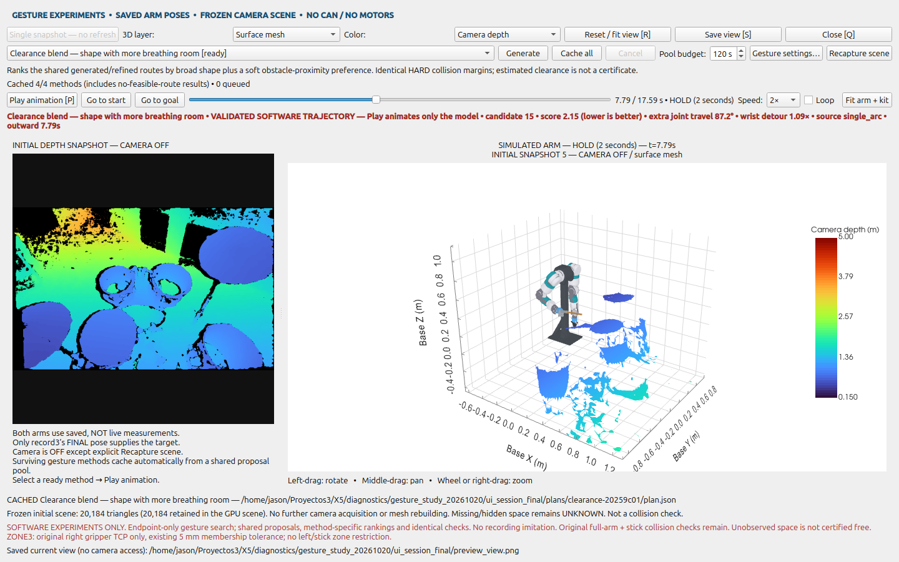

# Endpoint-only gesture study — results

## Outcome

Four candidates are retained in `./plan_drums.sh experiment`: **Joint progress, Broad sweep, Single arc, Clearance blend**. No universal winner is claimed. The former five experimental menu entries are removed; standalone hardware baseline is unchanged.

Everything was offline. The saved camera scene, measured start and calibrated robot/custom-gripper/stick model from the previous comparison were reused. The main goal remained the record3 final joint pose. No motors or camera were accessed. Record3 intermediate positions entered only the post-generation evaluator, never planning inputs, seeds, required waypoints or a learned policy.

## What was tested

- **8 initial hypotheses** on 4 task/seed combinations: current-style RRT control, endpoint-economy reranking, partial-joint shortcuts, compact endpoint corridors, monotonic phase curves, unseeded low-frequency arches, elastic deformation, and clearance-balanced ranking. These are practical implementations/variants, not eight new published algorithms.
- **5 compact-route variants** on 15 development combinations: 5 tasks × 3 seeds. Compact corridor generation became the common backbone; its separate selector was folded into the other modes.
- **18 reserved combinations**: 6 held-out tasks × the same 3 seeds, after freezing objectives and method definitions. Four public methods succeeded in all 18, including explicit compact fallbacks.
- In total, **33 final-generation trials**, on 11 distinct start/goal pairs with seeds 19, 127 and 509. Five perturbations change the start by at most 1.5° per joint (stick-tip shifts 2.1–3.5 cm); five change the goal by at most 3° (tip shifts 2.3–5.6 cm). The main case and all start-perturbation cases retain the exact record3 goal.
- The original right zone3 TCP definition, collision margins, model and acquired-scene self-filter remained fixed. Perturbed poses did not remask/rewrite the scene. No manual obstacles were added.

## Main task: comparison to the ACTUAL standalone baseline

The baseline below is the previously selected standalone `baseline-ed3647/calculate-d0efbf1e/plan/result/plan.json`, not the experiment control. New-method values are medians of the three main-task seeds. This is an equal-start/equal-goal comparison among baseline and generated routes.

| Method | Extra joint travel ↓ | Wrist path/direct distance ↓ | Tip +X goal overshoot ↓ | Recording tip-shape residual RMS ↓ | Nominal outward duration |
|---|---:|---:|---:|---:|---:|
| Saved standalone baseline | 69.2° | 1.471 | 13.34 cm | 17.72 cm | 5.78 s |
| Joint progress | 40.7° | 1.183 | 6.59 cm | 12.23 cm | 51.14 s |
| Broad sweep | 40.7° | 1.204 | 6.59 cm | 12.30 cm | 44.55 s |
| Single arc | 64.5° | 1.204 | 5.30 cm | 12.30 cm | 7.78 s |
| Clearance blend | 48.8° | 1.127 | 5.36 cm | 12.78 cm | 7.79 s |

**Important:** some geometric winners have very slow corner-stop timing. They are retained because the requested evaluation does not eliminate good shapes just for being slower. Timing is not hidden or described as improved. Continuous smooth proposals are tried first; a corner-stop fallback preserves a feasible geometric route when spline smoothing violates a limit/collision/zone check. The original timing method and derivative limits are unchanged.

For context, raw record3 has 31.4° extra joint travel, wrist ratio 1.169 and +X tip overshoot 1.32 cm. **Its start is different**: the stick starts about 44.9 cm away and 36.9 cm higher. It also fails the current buffered collision model at 342/801 samples in the previous comparison. Neither imitation nor these numbers establish physical superiority/safety.

## Held-out results: separate criteria, no combined evaluation score

Values are medians across the 18 reserved combinations. Lower is better except clearance. Nearby-goal similarity is a shape diagnostic, not a claim that the ride recording is the correct route for a different destination.

| Method | Extra travel | Wrist detour ratio | Broad wrist turning | Tip-shape residual | Joint-shape residual | Soft proximity penalty |
|---|---:|---:|---:|---:|---:|---:|
| Joint progress | 25.7° | 1.167 | 158.8° | 12.62 cm | 4.40° | 0.219 |
| Broad sweep | 27.8° | 1.155 | 149.6° | 12.38 cm | 4.69° | 0.220 |
| Single arc | 29.7° | 1.158 | 148.2° | 12.71 cm | 4.69° | 0.211 |
| Clearance blend | 35.3° | 1.088 | 103.1° | 12.85 cm | 4.95° | 0.161 |

**Interpretation:** Joint progress generally saves angular backtracking. Broad sweep sometimes improves broad route shape on nearby tasks. Single arc offers low-frequency curves but frequently selects a compact fallback when its generated arcs are not better. Clearance blend gives the best median wrist economy/turning and lower estimated proximity penalty, at the cost of more angular travel and sometimes less recording similarity. These are trade-offs for human review, not proof of one universally humanlike optimum.

Held-out selection provenance:
- Joint progress: 9/18 from progress, 9/18 from corridor.
- Broad sweep: 14/18 from corridor, 4/18 from sweep.
- Single arc: 15/18 from corridor, 3/18 from single_arc.
- Clearance blend: 4/18 from progress, 8/18 from single_arc, 1/18 from sweep, 5/18 from corridor.

Selecting a fallback is explicitly reported. Several methods may select the same candidate on the same task. No extra differences are fabricated.

## Eliminations and why

- **Strict monotonic phase curves:** no own valid selected route in the initial four tests; all results were fallback routes. Do not spend longer forcing zero reversals where obstacle avoidance may need some. This was a search failure, not proof that a monotonic solution cannot exist.
- **Unrestricted RRT plus new ranking alone:** reranking improved motor travel but left substantially larger detours and recording-shape residuals than compact corridors. A better proposal domain mattered more than changing only the score.
- **Partial/elastic refinement of unrestricted routes as the main method:** local changes did not reliably remove the underlying large detour. Reused these useful operations on freshly generated compact routes instead.
- **Unseeded low-frequency arches:** too unreliable (one own selected route out of four). Replaced with low-frequency search initialized by an endpoint-generated compact route, not by any demonstration.
- **Standalone Compact mode:** folded into every surviving mode as initializer/fallback. It is not declared physically bad; a separate selector duplicated a strict subset of Joint progress’s choices under the same objective.
- **Kept Broad sweep despite close medians:** it improved useful individual cases, including development goal2/509 and start1/127. A near tie is not grounds to discard a potentially useful motion style.

## How the measurements avoid trivial imitation

Extra travel is Σj(total absolute angular travel − absolute net endpoint change). Detour ratios divide wrist/tip travel by their own endpoint displacement. Broad turning uses 5 cm spatial chords. Overshoot is measured against endpoint bounds, not a recorded corridor. These quantities are based only on the current task and can be evaluated at other destinations.

The evaluation also records raw joint-arc-aligned wrist/tip RMS errors. Because the recorded start differs, a separate shape comparison resamples each spatial curve by its own arc and subtracts its own straight endpoint chord: r(s)=x(s)−[(1−s)x(0)+s x(1)]. RMS differences between these residuals describe departures from a direct route. Joint-space residuals are similarly measured in degrees. This subtraction is **only an evaluation statistic**; it never retargets/collision-validates the demonstration or supplies points to a planner. It does not make the original tasks identical.

No aggregate quality-plus-imitation score was used to declare a winner. Default objective formulas and limitations are documented in [the experiment guide](../../DRUM_PLANNER_EXPERIMENTS.md). The selection decision was written before held-out trials in [selection_before_holdout.md](selection_before_holdout.md).

## Verification

One implementation correction was made after native UI inspection: two effectively identical geometric paths differed by only about 2e-9 in soft score, allowing a slower resampled copy to win. Scores now use the production scorer’s eight-decimal precision convention before the existing candidate-index tie-break. No elapsed-time preference, objective weight or recording term was added. All 33 proposal-seed choices were checked unchanged; every pool was reranked, reevaluated and reverified. Only two selections changed. See [precision_fix.json](precision_fix.json). This is disclosed rather than represented as part of the original frozen implementation.

- Refine: 40 distinct selected trajectories independently passed the **unchanged production backend**, with 540,423 dense samples plus ≤0.003 rad edge checks. Polynomial extrema, exact endpoints, derivative limits and outward/2-second-hold/exact-return cycle were also checked.
- Heldout: 42 distinct selected trajectories independently passed the **unchanged production backend**, with 537,342 dense samples plus ≤0.003 rad edge checks. Polynomial extrema, exact endpoints, derivative limits and outward/2-second-hold/exact-return cycle were also checked.
- 518 automated regression tests passed, including existing baseline/controller mocks and renderer/zone/cache tests.
- The actual CLI ran all four modes from default saved inputs. Native GUI tests played a complete cycle for every mode and exercised play/pause, timeline, speed, loop, start/goal, layers/colors, camera navigation, image saving, settings accept/cancel, cancellation/resume, budget invalidation, regeneration, and failure recovery.
- Recapture success/failure was tested with an explicit offline filesystem fixture, **not the physical camera**. It confirmed old-scene retention on failure and cache/mesh replacement on success.
- Final study planning workers peaked at 373.7 MiB. The largest logged job including initial compilation/setup peaked at 1199.3 MiB. Hard job limits remain 3 GiB RAM and 128 MiB swap; no OOM occurred. Full existing mesh quality was retained. No additional dependency or GPU-compute port was necessary.
- Protected recordings, scene/calibration inputs, grippers, model, zone3, standalone baseline sources and launchers passed the preservation audit. No motor commands or live camera captures were performed.

## Limits and next step

This establishes improved geometric choices and local robustness on **one frozen kit scene**, not universal humanlike planning, measured physical safety, or physical speed. The small start/goal variations were intentional. Actual visual preference remains for the user to judge. No hardware rollout was authorized or attempted.

Run `./plan_drums.sh experiment`, wait for caching, then compare the four modes. The source tag and duration distinguish refinements from compact fallbacks. The software experiment cannot energize the arm.

Raw evidence: [summary.json](summary.json), [cases.json](cases.json), [protocol.md](protocol.md), [verification.json](verification.json), per-trial result/evaluation JSON, complete candidate files and terminal logs.
